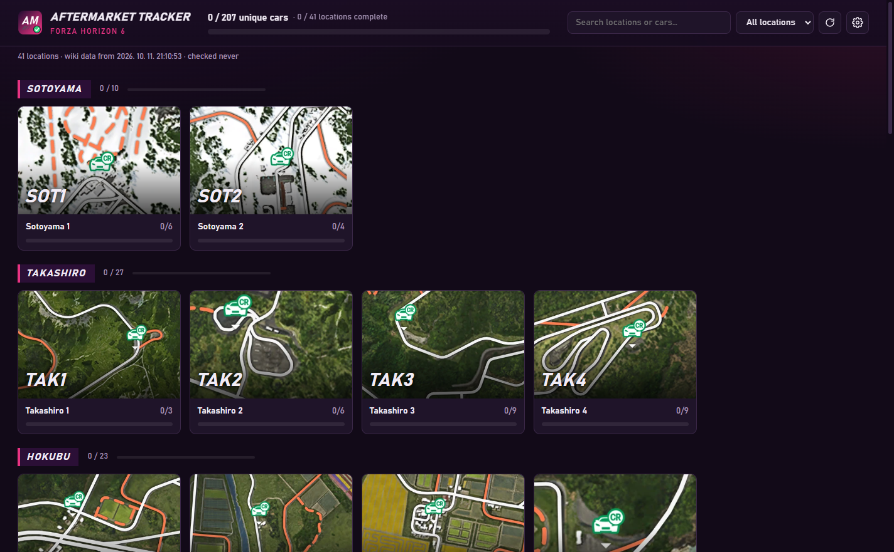
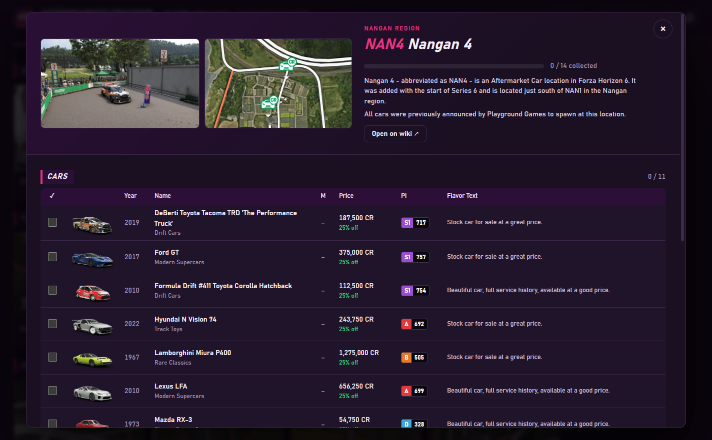
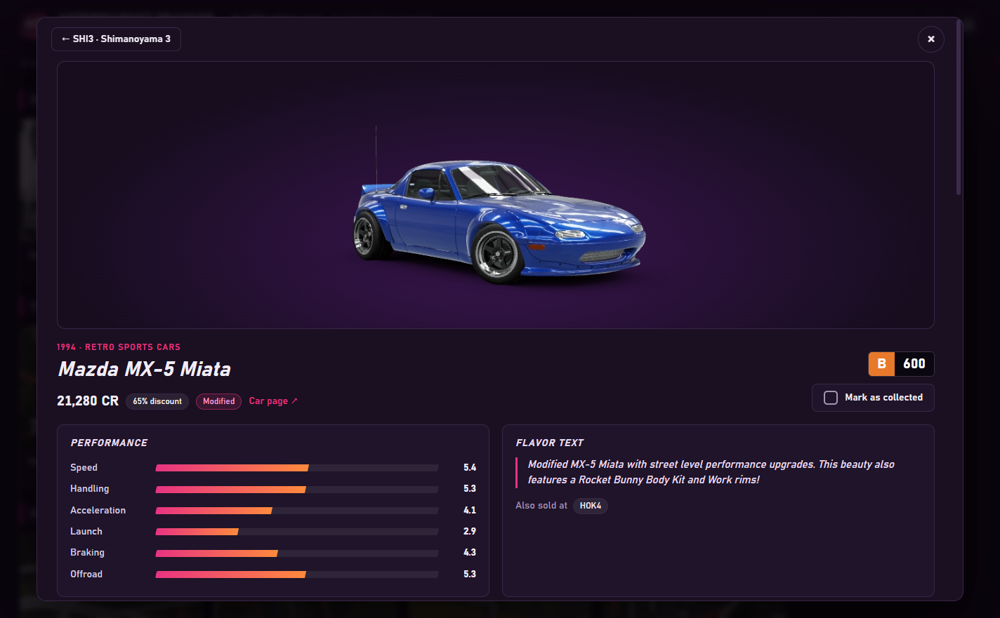
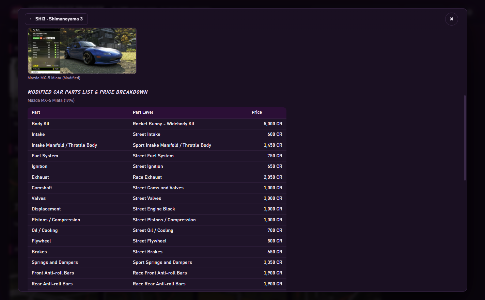

# Aftermarket Tracker

A small Windows desktop app for tracking your **Forza Horizon 6 Aftermarket Car** collection.
All locations, cars, stats, parts lists and images come live from the
[Forza wiki](https://forza.fandom.com/wiki/Forza_Horizon_6/Cars/Aftermarket), so new spots and
new cars show up automatically.



## Features

- **Location cards** with the wiki's map image, the location code and a collection progress bar, grouped by region
- **Per-location car lists** grouped like the wiki (launch pool, series updates, notable vehicles,
  past Evolving World events), with checkboxes, plus the location's trivia
- **Car details**: big image, Speed / Handling / Acceleration / Launch / Braking / Offroad,
  flavor text, in-game photos, and the parts list, price breakdown and tuning for modified cars
- **NEW badges** when the wiki adds a location or new cars to one
- **Smart caching**: wiki pages are downloaded again only when they change, and images only when the wiki uploads a new version
- Search, filters, and an option to link identical cars across locations

| Location | Car details | Parts & price breakdown |
| --- | --- | --- |
|  |  |  |

## Running

Download the portable `.exe` from the Releases page, or run it from source:

```bash
npm install
npm start
```

To build the portable executable yourself:

```bash
npm run dist    # -> dist/AftermarketTracker-<version>-portable.exe
```

The exe isn't code-signed, so Windows SmartScreen may warn you on the first launch
(**More info → Run anyway**).

Your collection is saved in `%APPDATA%\Aftermarket Tracker\collection.json`.

## Maintenance

The app scrapes the wiki's rendered pages, so a layout change on the wiki can break it.
[AGENTS.md](AGENTS.md) describes the page structure the parser expects and gives a
step-by-step fix-up playbook. `npm run check-wiki` checks the parser against the live wiki.

## Credits

Game data and images come from the community-run [Forza Wiki](https://forza.fandom.com) on Fandom
(content licensed under [CC BY-SA](https://www.fandom.com/licensing)). This is an unofficial fan
project and isn't affiliated with Playground Games, Turn 10, Xbox Game Studios or Fandom.
